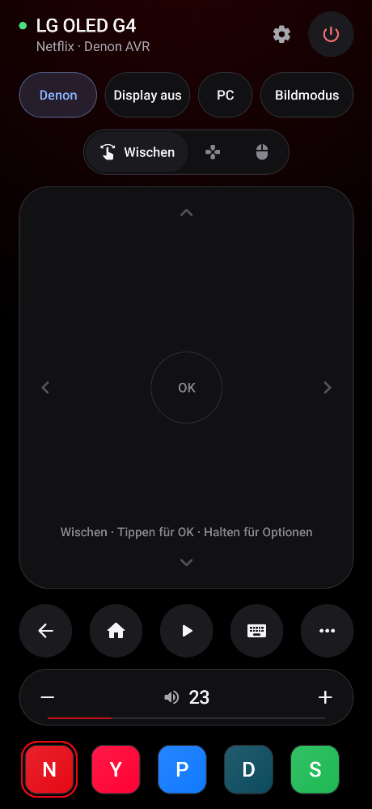
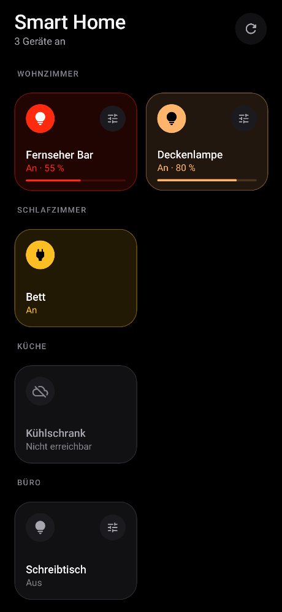
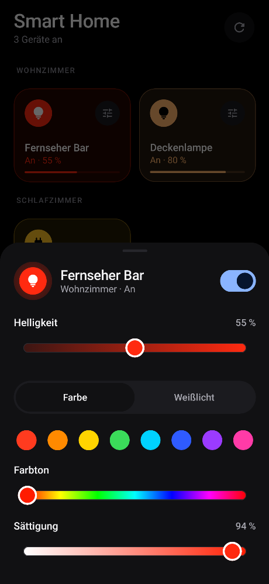

# LG Remote

Android-Fernbedienung für den **LG OLED G4** mit gerootetem webOS und
[Modern-LG-Hub](https://github.com/paulhoehne2006-a11y/Modern-LG-Hub). Spricht direkt
mit dem Hub auf dem Fernseher (`http://<tv-ip>:8080`), ohne Cloud. Nur der Mauszeiger braucht eine
einmalige Kopplung am TV, nur Gemini nutzt die Google-Cloud.

<p>
  
  
  
  
  
</p>

## Funktionen

**Fernbedienung**
- Wischfeld: ein Schritt pro ~36 dp, achsenstabil (keine Doppelschritte bei schrägem Wischen),
  weit wischen und Finger liegen lassen = Dauerscrollen, Tippen = OK
- Alternativ klassisches Steuerkreuz (Halten wiederholt) oder Mauszeiger (webOS Magic Remote)
- Schnellschalter: Audioausgabe Denon ⇄ TV (lange drücken für alle Ausgänge), Display aus/an
  (Audio läuft weiter), PC (HDMI 1), Bildmodus
- Lautstärke über die Tasten des Handys oder −/+ (Halten wiederholt; beim Loslassen stoppt der TV sofort), Texteingabe mit der Handytastatur (live ins Suchfeld),
  Ziffern, Farb- und Medientasten
- Einschalten per Wake-on-LAN (die MAC lernt die App vom Hub, sobald der TV einmal an war; auch mit VPN)
- Hoch- und Querformat, große Schrift, eigene Anzeige für jeden Zustand (erster Start, TV aus, Hub nicht erreichbar, Token falsch)

**Weitere Bereiche**
- **Apps** – alle Apps und HDMI-Eingänge mit echten Icons vom Fernseher
- **Smart Home** – WiZ-Lampen und Tapo-Steckdosen, lokal über den Hub, nach Räumen sortiert; Lampen mit Helligkeit, Farbe, Sättigung und Weißlicht (lange drücken oder Regler-Symbol)
- **Gemini** – Befehle per Text oder Sprache („Display aus, Musik soll weiterlaufen“)

**System-Integration (One UI)**
- Schnelleinstellungs-Kachel öffnet die Mini-Fernbedienung; 2×2-Widget mit vier frei belegbaren Tasten
  (Aktionen direkt, die Taste „Remote“ öffnet die Mini-Fernbedienung, der Kopf die App)
- Optionale *Live-Steuerung*: Steuerung im Sperrbildschirm / in der Now Bar, die Medienlautstärke
  regelt den TV; fragt den TV nur im Heimnetz (WLAN/Ethernet) ab und seltener, solange er aus ist
- App-Verknüpfungen und Ziel für *Modi und Routinen*
  (Intent `com.modernlghub.remote.action.SHORTCUT`, Extra `action` = `screen_off` (Display aus/an),
  `pc`, `audio_toggle`, `power` (umschalten), `power_on`, `power_off`, `mute`, `play_pause`, `home`,
  `netflix`, `youtube`, `spotify`, `overlay`)

## Einrichtung

1. Modern-LG-Hub auf dem Fernseher starten (`gemini-tv-controller/server.py`).
2. APK aus den [Releases](../../releases/tag/latest) installieren.
3. App öffnen → **Einstellungen** → *Im WLAN suchen* (oder IP von Hand eintragen).

## Bauen

```bash
./gradlew testDebugUnitTest lintDebug assembleDebug
```

Bildschirmfotos in `docs/screenshots/` neu erzeugen (JVM, ohne Gerät):

```bash
./gradlew testDebugUnitTest --tests '*ScreenshotTest*' -Pscreenshots
```

JDK 21 und Android SDK 35. Jeder Push baut in GitHub Actions eine APK (Artefakt);
Pushes auf `main` aktualisieren zusätzlich das Release `latest`.

## Aufbau

| Pfad | Inhalt |
| --- | --- |
| `data/TvRepository.kt` | Zustand des Fernsehers, Polling bei sichtbarer UI oder aktiver Live-Steuerung, geordnete Tasten-Queue, Wake-on-LAN, Hub-Suche |
| `data/HubApi.kt` | HTTP zum Hub mit eigenen Timeouts pro Aufruf |
| `data/WebOsPointerClient.kt` | Mauszeiger über webOS SSAP (`wss://tv:3001`), Kopplung wird gespeichert |
| `ui/screens/` | Fernbedienung, Apps, Smart Home, Gemini, Einstellungen |
| `system/` | Mini-Fernbedienung, Kachel, Widget, Verknüpfungen, Live-Steuerung |

`app/src/main/assets/webos_pairing.json` stammt aus [lgtv2](https://github.com/hobbyquaker/lgtv2) (MIT).
