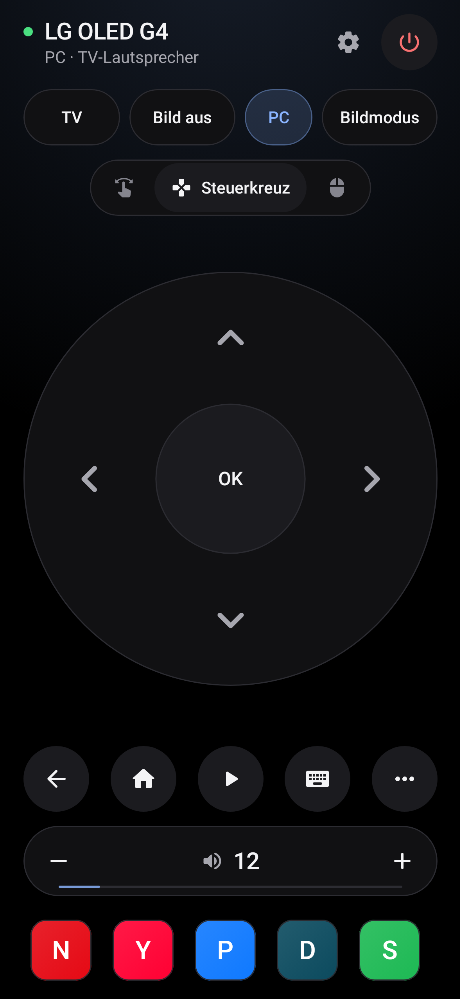
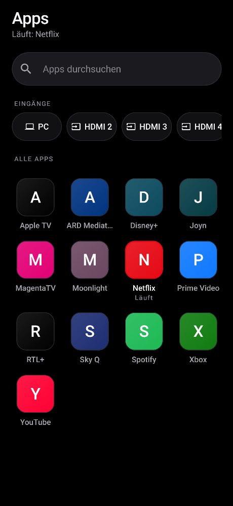

# LG Remote

Android-Fernbedienung für den **LG OLED G4** mit gerootetem webOS und
[Modern-LG-Hub](https://github.com/paulhoehne2006-a11y/Modern-LG-Hub). Spricht direkt
mit dem Hub auf dem Fernseher (`http://<tv-ip>:8080`), ohne Cloud und ohne Pairing.

<p>
  
  
  
  
  
</p>

## Funktionen

**Fernbedienung**
- Wischfeld: ein Schritt pro ~36 dp, achsenstabil (keine Doppelschritte bei schrägem Wischen),
  weit wischen und Finger liegen lassen = Dauerscrollen, Tippen = OK
- Alternativ klassisches Steuerkreuz (Halten wiederholt) oder Mauszeiger (webOS Magic Remote)
- Schnellschalter: Tonausgabe Denon ⇄ TV (lange drücken für alle Ausgänge), Bild aus/an
  (Audio läuft weiter), PC (HDMI 1), Bildmodus
- Lautstärke über die Tasten des Handys, Texteingabe mit der Handytastatur (live ins Suchfeld),
  Ziffern, Farb- und Medientasten
- Einschalten per Wake-on-LAN (MAC kommt automatisch vom Hub)

**Weitere Bereiche**
- **Apps** – alle Apps und HDMI-Eingänge mit echten Icons vom Fernseher
- **Zuhause** – WiZ-Lampen und Tapo-Steckdosen, lokal über den Hub, nach Räumen sortiert; Lampen mit Helligkeit, Farbe und Weißton (lange drücken oder Regler-Symbol)
- **Assistent** – Gemini-Befehle per Text oder Sprache („Bild aus, Musik soll weiterlaufen“)

**System-Integration (One UI)**
- Schnelleinstellungs-Kachel und 2×2-Widget (vier frei belegbare Tasten) öffnen die Mini-Fernbedienung
- Optionale *Live-Steuerung*: Steuerung im Sperrbildschirm / in der Now Bar, die Medienlautstärke
  regelt den TV; fragt den TV nur im WLAN ab
- App-Verknüpfungen und Ziel für *Modi und Routinen*
  (Intent `com.modernlghub.remote.action.SHORTCUT`, Extra `action` = `screen_off`, `pc`,
  `audio_toggle`, `power`, `mute`, `play_pause`, `home`, `overlay`)

## Einrichtung

1. Modern-LG-Hub auf dem Fernseher starten (`gemini-tv-controller/server.py`).
2. APK aus den [Releases](../../releases/tag/latest) installieren.
3. App öffnen → **Einstellungen** → *Im WLAN suchen* (oder IP von Hand eintragen).

## Bauen

```bash
./gradlew testDebugUnitTest assembleDebug
```

JDK 21 und Android SDK 35. Jeder Push baut in GitHub Actions eine APK (Artefakt);
Pushes auf `main` aktualisieren zusätzlich das Release `latest`.

## Aufbau

| Pfad | Inhalt |
| --- | --- |
| `data/TvRepository.kt` | Zustand des Fernsehers, Polling nur bei sichtbarer UI, geordnete Tasten-Queue, Wake-on-LAN, Hub-Suche |
| `data/HubApi.kt` | HTTP zum Hub mit eigenen Timeouts pro Aufruf |
| `data/WebOsPointerClient.kt` | Mauszeiger über webOS SSAP (`wss://tv:3001`), Kopplung wird gespeichert |
| `ui/screens/` | Fernbedienung, Apps, Zuhause, Assistent, Einstellungen |
| `system/` | Mini-Fernbedienung, Kachel, Widget, Verknüpfungen, Live-Steuerung |

`app/src/main/assets/webos_pairing.json` stammt aus [lgtv2](https://github.com/hobbyquaker/lgtv2) (MIT).
